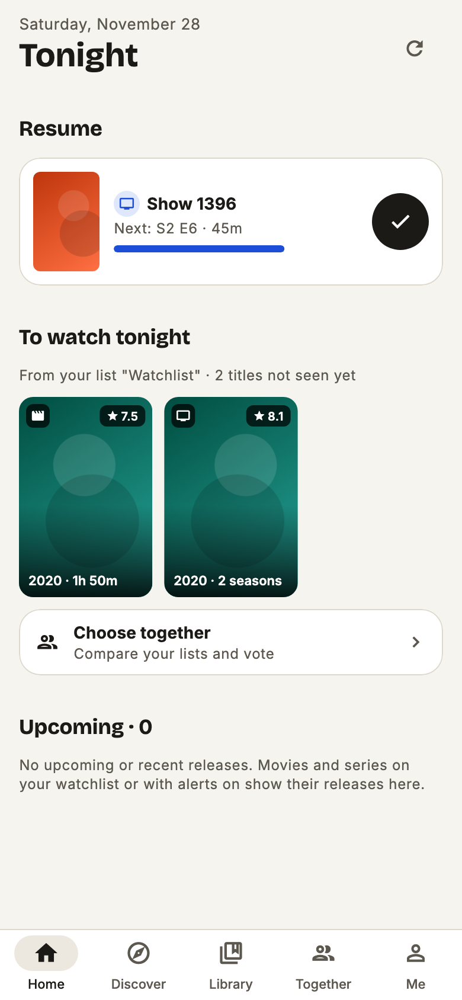
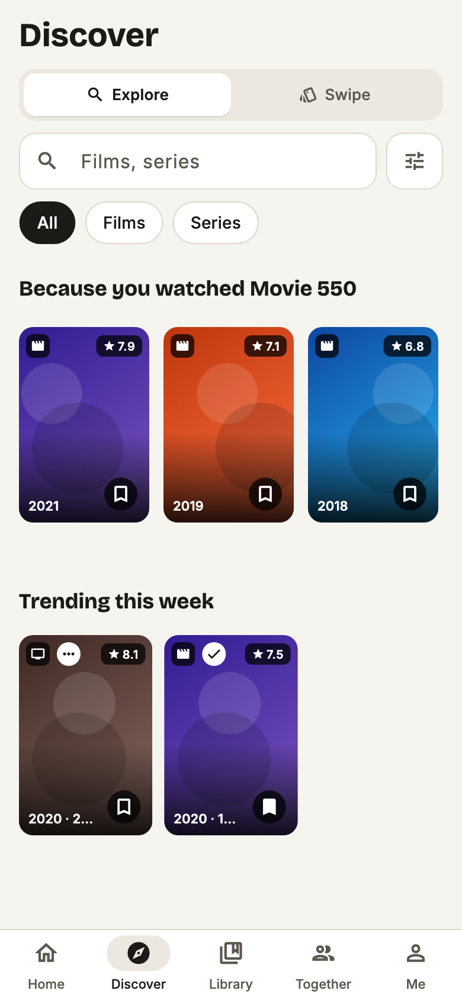
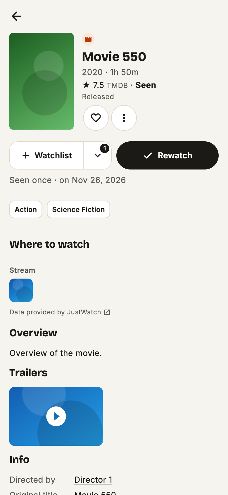
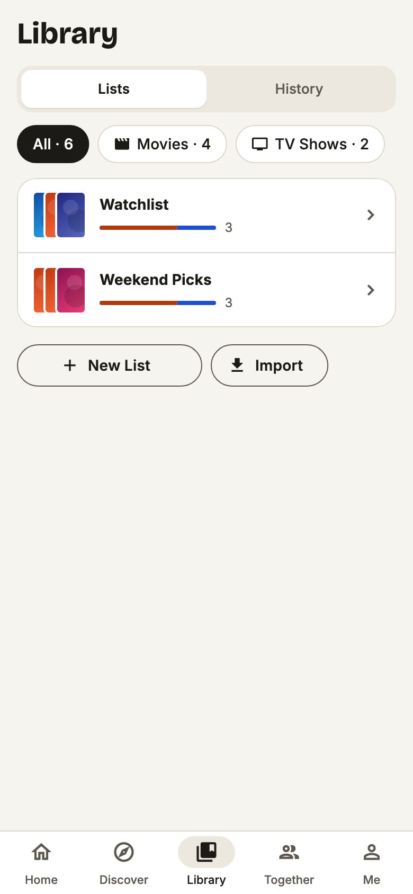
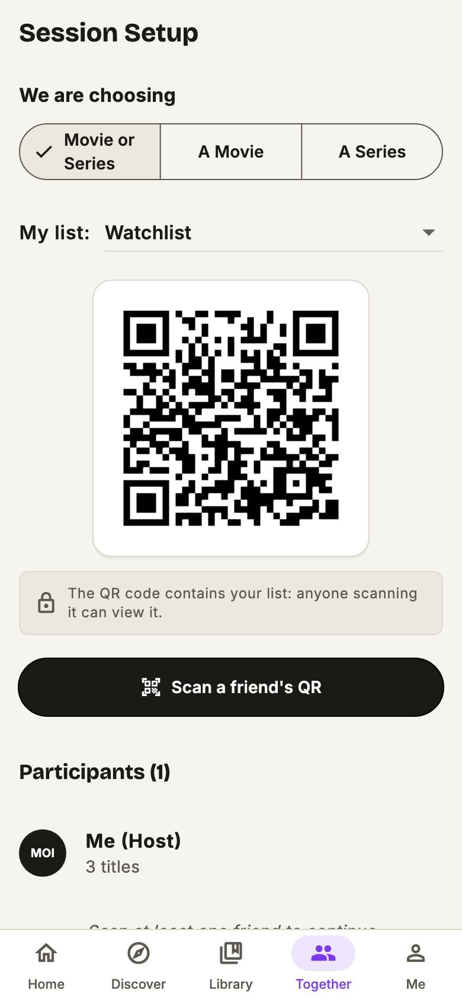
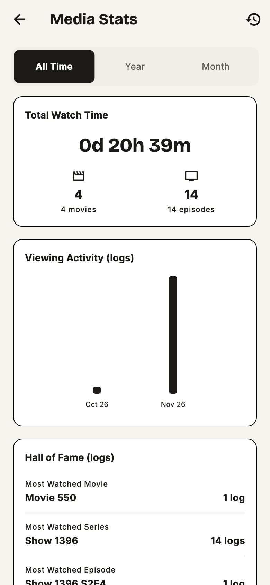

[English](README.md)

<p align="center">
  
</p>

<h1 align="center">MediaVore</h1>

<p align="center">
  Une application Flutter locale pour suivre les films et séries que vous avez vus ou souhaitez regarder.
</p>

<p align="center">
  <a href="https://github.com/Zimberts/MediaVore/releases/latest">
    
  </a>
  <a href="https://github.com/Zimberts/MediaVore/actions/workflows/ci.yml">
    
  </a>
  <a href="LICENSE">
    
  </a>
  
</p>

<p align="center">
  <a href="https://github.com/Zimberts/MediaVore/releases/latest/download/mediavore.apk">
    <strong>Télécharger l'APK Android (dernière version)</strong>
  </a>
  &nbsp;·&nbsp;
  <a href="https://github.com/Zimberts/MediaVore/releases">Toutes les versions</a>
  &nbsp;·&nbsp;
  <a href="https://zimberts.github.io/MediaVore/">Site web</a>
</p>

---

## Captures d'écran

<table>
  <tr>
    <td align="center">
      <br />
      <sub><strong>Accueil</strong></sub>
    </td>
    <td align="center">
      <br />
      <sub><strong>Découvrir</strong></sub>
    </td>
    <td align="center">
      <br />
      <sub><strong>Fiche média</strong></sub>
    </td>
  </tr>
  <tr>
    <td align="center">
      <br />
      <sub><strong>Bibliothèque</strong></sub>
    </td>
    <td align="center">
      <br />
      <sub><strong>Ensemble</strong></sub>
    </td>
    <td align="center">
      <br />
      <sub><strong>Statistiques</strong></sub>
    </td>
  </tr>
</table>

## Fonctionnalités

- **Accueil** : sélections « À regarder ce soir », suivi des séries en cours avec suggestion du prochain épisode, et sorties à venir (films et épisodes) groupées par période.
- **Découvrir** : recherche de films, séries et personnes sur TMDB avec filtres (tri, décennie, genres, note, durée, masquer les vus), tendances, rangées personnalisées « Parce que vous avez vu » et mode swipe optionnel.
- **Fiche média** : notes, plateformes de streaming « Où regarder » (JustWatch via TMDB), distribution cliquable et fiches de personnes, suivi des sagas/collections, saisons dépliables avec cases à cocher par épisode, cycles de revisionnage et édition des dates/nombre de vues (Mode avancé).
- **Bibliothèque** : listes personnalisées avec tri, filtres, sélection multiple et partage, ainsi qu'un historique de visionnage groupé par jour.
- **Ensemble** : choisissez quoi regarder à plusieurs hors ligne — échangez vos listes par QR code, affichez les titres en commun et votez en vous passant le téléphone.
- **Moi, Stats & Succès** : statistiques de temps de visionnage, succès à débloquer avec paliers et badges cachés, 6 palettes de thème (clair et sombre), interface en français et en anglais, et sauvegarde/restauration complète en ZIP/CSV (ajout, remplacement, fusion).

Pour les fonctionnalités prévues et les prochaines étapes, consultez les [issues GitHub](https://github.com/Zimberts/MediaVore/issues) (notamment le label [`v1.5.0`](https://github.com/Zimberts/MediaVore/labels/v1.5.0)).

## Installation

### Android

1. Téléchargez [`mediavore.apk`](https://github.com/Zimberts/MediaVore/releases/latest/download/mediavore.apk) (et éventuellement [`mediavore.apk.sha256`](https://github.com/Zimberts/MediaVore/releases/latest/download/mediavore.apk.sha256)).
2. *(Optionnel)* Vérifiez l'intégrité du fichier :
   ```sh
   sha256sum -c mediavore.apk.sha256
   ```
   *(Chaque version publiée fournit aussi `mediavore-vX.Y.Z.apk` et `mediavore-vX.Y.Z.apk.sha256`.)*
3. Autorisez l'installation depuis des sources inconnues si Android le demande, puis ouvrez l'APK pour l'installer.

### iOS

Il n'y a pas de distribution publique sur iOS pour le moment. Compiler pour iOS nécessite Xcode et un compte Apple Developer ; voir [DOCS/ios-release.md](DOCS/ios-release.md).

### Clé API TMDB

MediaVore récupère les métadonnées des films et séries (affiches, synopsis, dates de sortie, plateformes de streaming) depuis The Movie Database (TMDB) avec votre clé personnelle gratuite.

Au premier lancement, l'écran d'accueil vous guide vers les [paramètres API TMDB](https://www.themoviedb.org/settings/api) pour créer et coller votre clé API v3 ou votre jeton d'accès en lecture v4. Vous pouvez aussi passer cette étape et la configurer plus tard dans **Moi › Paramètres › Identifiant API TMDB**.

## Développement

### Prérequis

- Flutter `3.47.6` (version fixée dans [`.github/workflows/ci.yml`](.github/workflows/ci.yml))
- Dart `^3.10.4` (voir [`pubspec.yaml`](pubspec.yaml))

### Installation

```sh
flutter doctor
touch .env                                              # asset requis, non versionné
flutter pub get
dart run build_runner build --delete-conflicting-outputs
flutter test
./tool/screenshots.sh                                   # régénère DOCS/screenshots/*.png hors ligne
```

Installez les hooks git une fois par clone (vérifient Conventional Commits et `dart format`) :

```sh
pip install pre-commit
pre-commit install
```

### Documentation

- [AGENTS.md](AGENTS.md) — architecture, conventions et workflow
- [DOCS/deep-links.md](DOCS/deep-links.md) — configuration des Android App Links (`assetlinks.json`)
- [DOCS/i18n.md](DOCS/i18n.md) — guide d'internationalisation
- [DOCS/export-format.md](DOCS/export-format.md) — format d'export/import ZIP/CSV
- [DOCS/releasing.md](DOCS/releasing.md) — processus de release

## Contribuer

Les messages de commit et les titres de pull requests doivent respecter [Conventional Commits 1.0.0](https://www.conventionalcommits.org/en/v1.0.0/) (`<type>(<scope>)!: <description>`). Consultez [.ai/rules/commits.md](.ai/rules/commits.md) pour la liste des types autorisés, les scopes et le nommage des branches.

Lors de toute mise à jour de la documentation, gardez `README.fr.md` et [`README.md`](README.md) synchronisés.

## Mentions & Licence

<a href="https://www.themoviedb.org/">
  
</a>

- This product uses the TMDB API but is not endorsed or certified by TMDB.
- Données de disponibilité streaming fournies par [JustWatch](https://www.justwatch.com/) via TMDB.
- Distribué sous [licence MIT](LICENSE).
